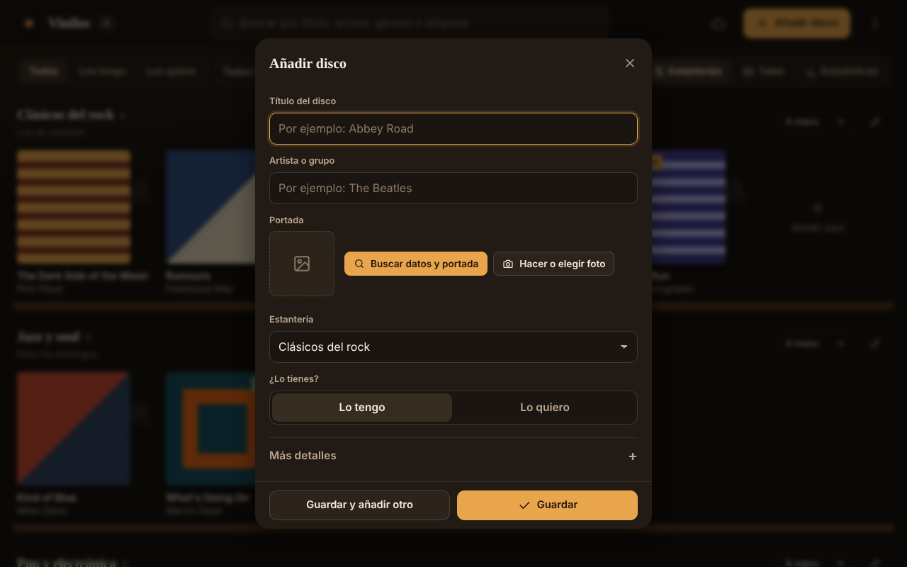
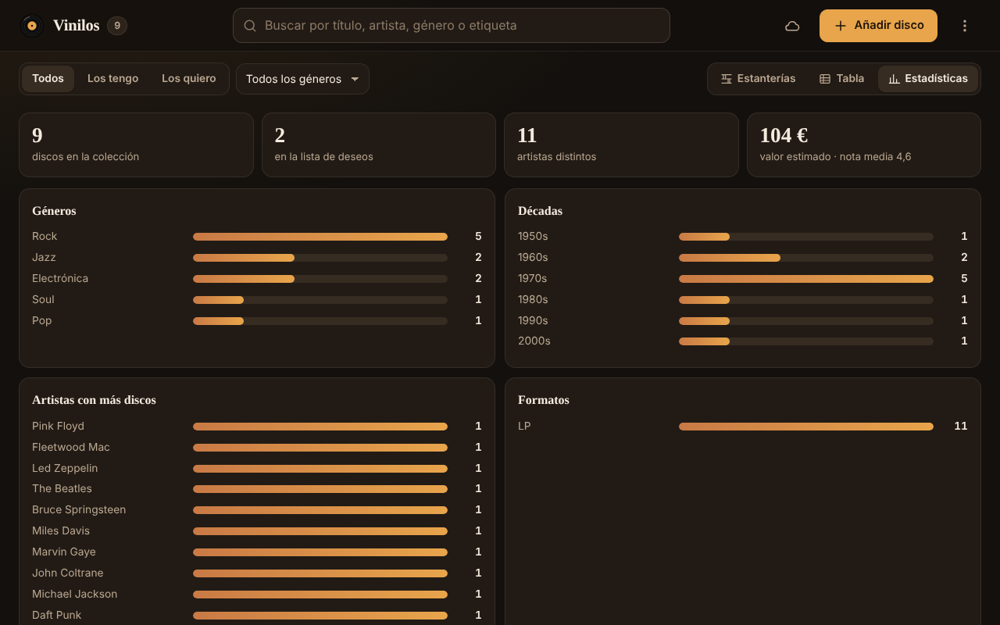
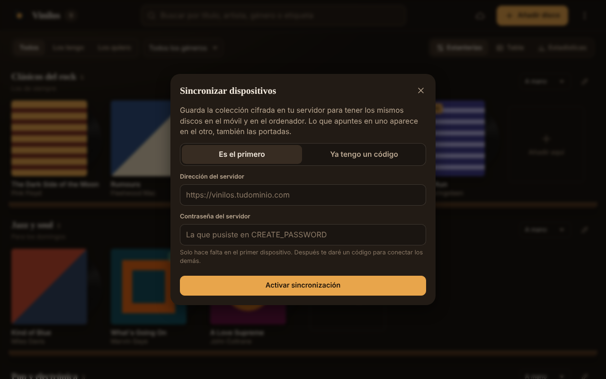

<p align="center"></p>

<p align="center">
  <a href="https://ivanchux.github.io/inventario-vinilos/"></a>
  <a href="https://github.com/ivanchux/inventario-vinilos/actions/workflows/deploy.yml"></a>
  
  
  <a href="LICENSE"></a>
</p>

<p align="center"><b>Tu colección de vinilos en estanterías, con portadas, estadísticas y la misma colección en el móvil y en el ordenador.<br>Funciona sin conexión, se instala como una app y no necesita cuentas.</b></p>

<p align="center"></p>

> Nació para digitalizar la colección de vinilos de mi padre (varios cientos de discos apuntados a mano desde los años 80). La versión 2 se rehízo por dentro para que **no se pueda perder ni un disco**: lo que pasó con la versión anterior está explicado más abajo.

## Qué hace

**Organizar**
- Estanterías con los discos en carrusel. Se ordenan a mano (arrastrando, en el ordenador), por artista, año, título o los más recientes.
- Vista de **tabla** ordenable y exportable a Excel, y vista de **estadísticas** (géneros, décadas, artistas, formatos, valoraciones, valor estimado).
- Búsqueda por título, artista, género, año o etiqueta; filtros «Los tengo / Los quiero» y por género.

**Añadir discos sin esfuerzo**
- Escribe el título y el artista y pulsa **Buscar datos y portada**: la app consulta [MusicBrainz](https://musicbrainz.org) y [Cover Art Archive](https://coverartarchive.org) y rellena año, género y portada.
- O haz una foto a la portada con el móvil: se comprime sola.
- «Guardar y añadir otro» para meter muchos discos seguidos.

**Cada disco, con su ficha**
- Portada con el vinilo del color real, valoración con un toque, precio, estado, fecha de compra, canciones, etiquetas y notas.
- Escuchar un archivo de audio propio desde la ficha (el vinilo gira) y enlace a YouTube.
- **Resumen del año** tipo *Wrapped* y botón **Sorpréndeme**.

**Tus datos, a salvo**
- **Sincronización entre dispositivos** con tu propio servidor, **cifrada en el dispositivo** (el servidor no puede leer nada). Se fusiona disco a disco: lo que apuntas en el móvil aparece en el ordenador y al revés, portadas incluidas.
- **Buscador de discos repetidos** para unir los que se apuntaron dos veces.
- **Copias automáticas** en el propio dispositivo (una al día y antes de cada cambio grande), restaurables con un clic.
- **Copia de seguridad** en un archivo (con portadas) y recordatorio si hace tiempo que no se hace. Importar permite **añadir** o **sustituir**.
- Cinco temas de color, incluido uno claro.

<table>
  <tr>
    <td width="50%"><br><sub><b>Ficha</b>: portada, vinilo, valoración y datos.</sub></td>
    <td width="50%"><br><sub><b>Añadir</b>: busca los datos y la portada por ti.</sub></td>
  </tr>
  <tr>
    <td><br><sub><b>Tabla</b>: ordenable y exportable a Excel.</sub></td>
    <td><br><sub><b>Estadísticas</b> de toda la colección.</sub></td>
  </tr>
  <tr>
    <td><br><sub><b>Móvil</b>: navegación inferior y botón de añadir siempre a mano.</sub></td>
    <td><br><sub><b>Sincronizar</b> el móvil y el ordenador.</sub></td>
  </tr>
</table>

> Las portadas de las capturas son ilustraciones abstractas generadas para la demo, no portadas reales.

## Por qué no se pierden datos

La versión 1 guardaba toda la colección como un único bloque. Si el navegador fallaba un instante al leerlo (pasa en Safari para iPhone al volver a una web tras un rato), la app arrancaba vacía y **guardaba ese vacío encima de la colección buena**. Además, nada impedía que el navegador borrase los datos de una web poco usada. La versión 2:

| Riesgo | Cómo se evita |
|---|---|
| Un fallo al leer deja la app vacía y pisa los datos | Si no puede leer, reintenta y, si sigue fallando, **avisa y no escribe nada**. |
| Una ventana pisa los cambios de otra | Cada disco se guarda por separado; las demás ventanas se actualizan solas. |
| El navegador borra los datos por su cuenta | Pide almacenamiento persistente, sincroniza con el servidor y recuerda hacer copias. |
| Un error al importar o restaurar | Antes de cualquier cambio grande se guarda una **copia automática** restaurable. |
| Actualizar la app | La migración desde la versión 1 **no borra el original** y deja una copia de antes del cambio. |

Todo esto está cubierto por pruebas automáticas que se ejecutan en GitHub antes de cada publicación (`tests/e2e.py`, con un navegador real).

## Instalarla como app

- **iPhone (Safari)**: Compartir → *Añadir a pantalla de inicio*. Ábrela siempre desde ese icono: en iPhone, Safari y la app instalada guardan los datos por separado.
- **Android / ordenador (Chrome o Edge)**: menú del navegador → *Instalar aplicación*.

## Sincronización: montar el servidor

El servidor está en [`server/`](server/): Node ≥ 18, **sin dependencias**, un solo archivo. Guarda la colección cifrada y un número de versión para que dos dispositivos no se pisen.

**En Coolify (o cualquier Docker):**

1. Nuevo recurso desde este repositorio, tipo de build **Dockerfile**, ruta `server/Dockerfile`, contexto la raíz.
2. Puerto **8787**, volumen persistente en **`/data`**.
3. Variables: `CREATE_PASSWORD` (para que nadie más cree colecciones en tu servidor) y `ALLOWED_ORIGIN=https://ivanchux.github.io`.
4. Dominio con https (Coolify lo gestiona). El contenedor sirve también la app, así que puedes usarla directamente desde ese dominio.

```bash
# En local
CREATE_PASSWORD=una-clave node server/server.js      # http://localhost:8787
# Con Docker
docker build -f server/Dockerfile -t vinilos .
docker run -d -p 8787:8787 -v vinilos-data:/data -e CREATE_PASSWORD=una-clave vinilos
```

Si pones la dirección del servidor en [`js/config.js`](js/config.js), la app ya la trae rellenada.

**En la app**: botón de la nube → «Es el primero» en un dispositivo (dirección + contraseña). Te da un **código** y un **enlace**: ábrelo en el otro dispositivo y listo. Si los dos ya tenían discos, se juntan y la app ofrece unir los repetidos.

| Variable | Para qué |
|---|---|
| `PORT` | Puerto (8787) |
| `DATA_DIR` | Carpeta de datos (`/data` en Docker) |
| `CREATE_PASSWORD` | Contraseña para crear colecciones nuevas |
| `ALLOWED_ORIGIN` | Orígenes permitidos, separados por comas |
| `STATIC_DIR` | Si se indica, sirve también la app |
| `MAX_VAULT_MB` / `MAX_BLOB_MB` | Límites de tamaño (8 y 4 MB) |

## Stack y estructura

HTML, CSS y JavaScript con módulos nativos, sin frameworks ni paso de compilación. Datos en **IndexedDB**, cifrado con **Web Crypto** (AES-GCM + PBKDF2), PWA con service worker.

```
├── index.html            estructura de la página
├── css/app.css           estilos y temas
├── js/
│   ├── app.js            arranque, estado y vistas (estanterías, tabla, estadísticas)
│   ├── dialogos.js       ficha, editor, menú, sincronización, copias…
│   ├── store.js          capa de datos (IndexedDB, migración, copias)
│   ├── sync.js           sincronización cifrada y fusión
│   ├── portadas.js       compresión de fotos y búsqueda en MusicBrainz
│   └── ui.js, iconos.js, util.js, config.js
├── server/               servidor de sincronización + Dockerfile
├── tests/e2e.py          pruebas con navegador real
└── service-worker.js     funcionamiento sin conexión
```

## Probarlo en local

```bash
git clone https://github.com/ivanchux/inventario-vinilos.git
cd inventario-vinilos
node server/server.js              # sirve la app y la sincronización en http://localhost:8787
# o solo la app: python3 -m http.server 8000

# pruebas
node --test server/server.test.js
pip install playwright && python -m playwright install chromium && python tests/e2e.py
```

## 📜 Licencia

El código y los diseños están bajo [PolyForm Noncommercial 1.0.0](https://github.com/Ivanchux/inventario-vinilos/blob/main/LICENSE).

**Puedes, sin pedir permiso:**

* Usar la app para tu colección y compartir el enlace.
* Estudiar el código y modificarlo para uso personal, educativo o sin ánimo de lucro.
* Subirla a tu propio hosting, siempre gratis y sin anuncios, conservando el aviso de copyright y la licencia.
* Hacer vídeos, capturas y reseñas de la app, aunque tu canal esté monetizado.
* Inspirarte en las ideas y el funcionamiento para crear tu propia app desde cero.

**Necesitas mi permiso por escrito para:**

* Vender la app, una copia o una versión modificada.
* Publicarla en tiendas de aplicaciones.
* Incluirla en una web con anuncios, suscripciones o compras.
* Usar el código o los diseños en un producto comercial.

La estética del resumen anual se inspira en los resúmenes tipo "Wrapped", pero este proyecto no está afiliado a Spotify ni a ninguna otra plataforma de música. Las portadas y los datos de los discos pertenecen a sus respectivos autores y sellos.
