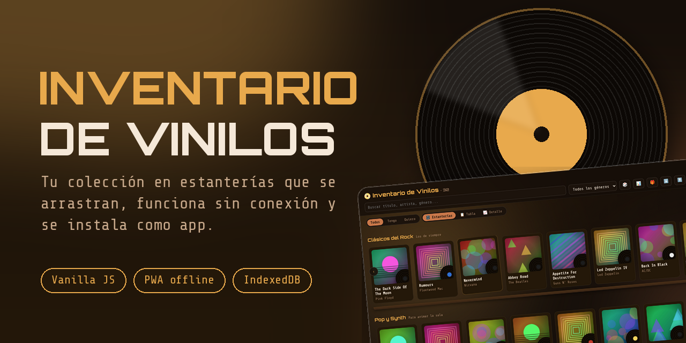
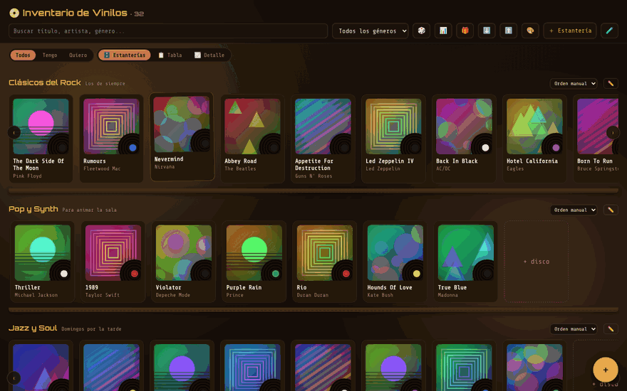
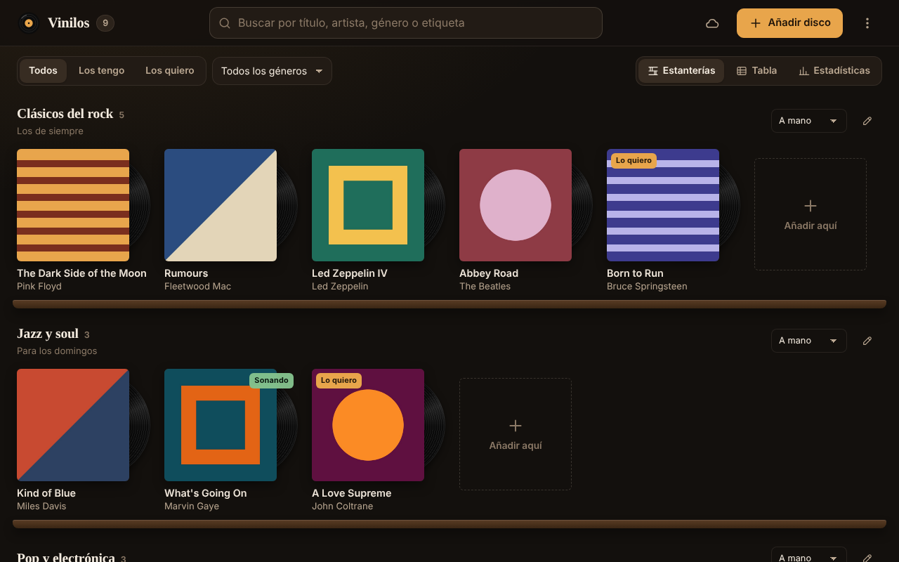
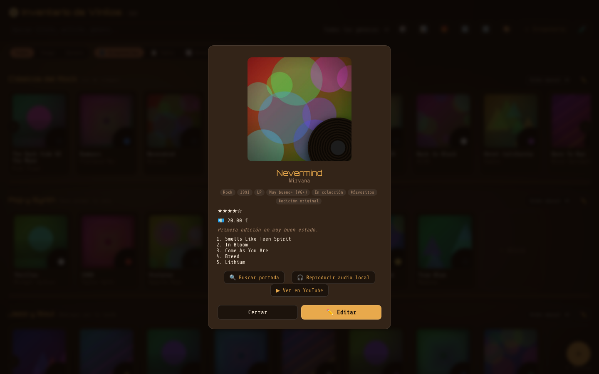
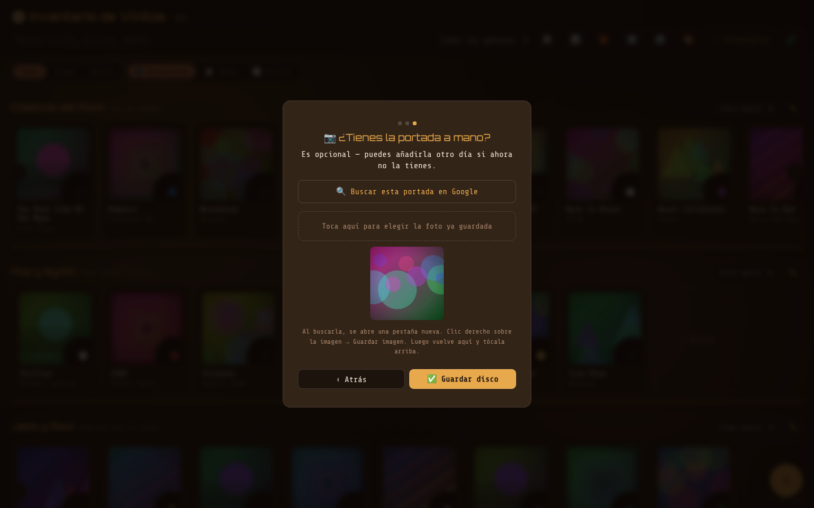
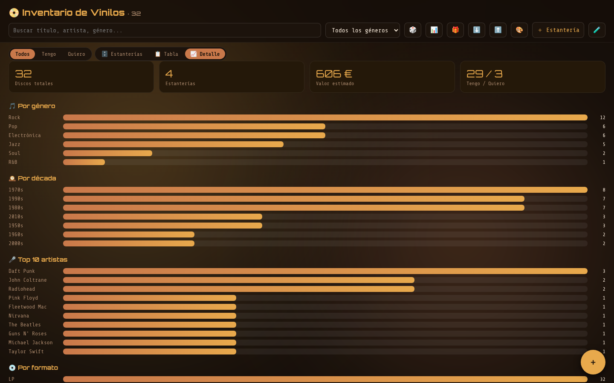
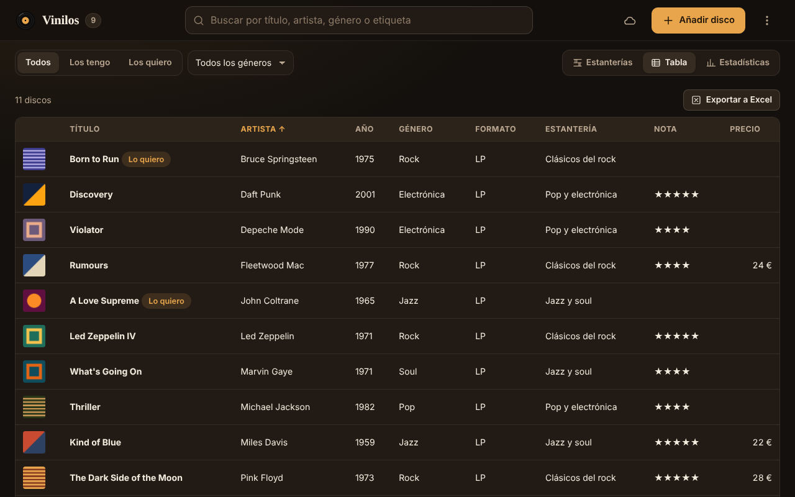
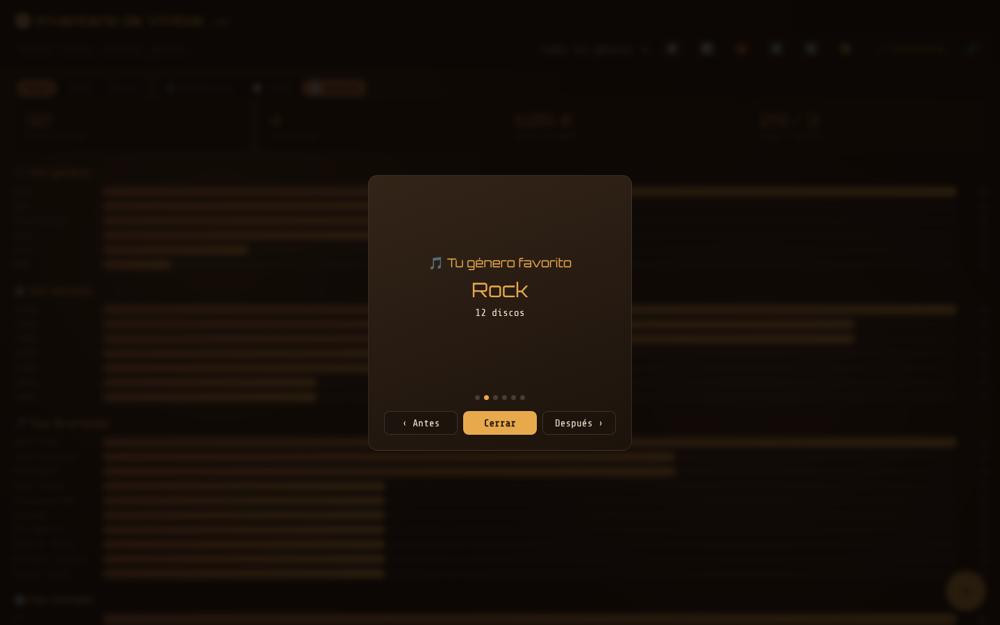
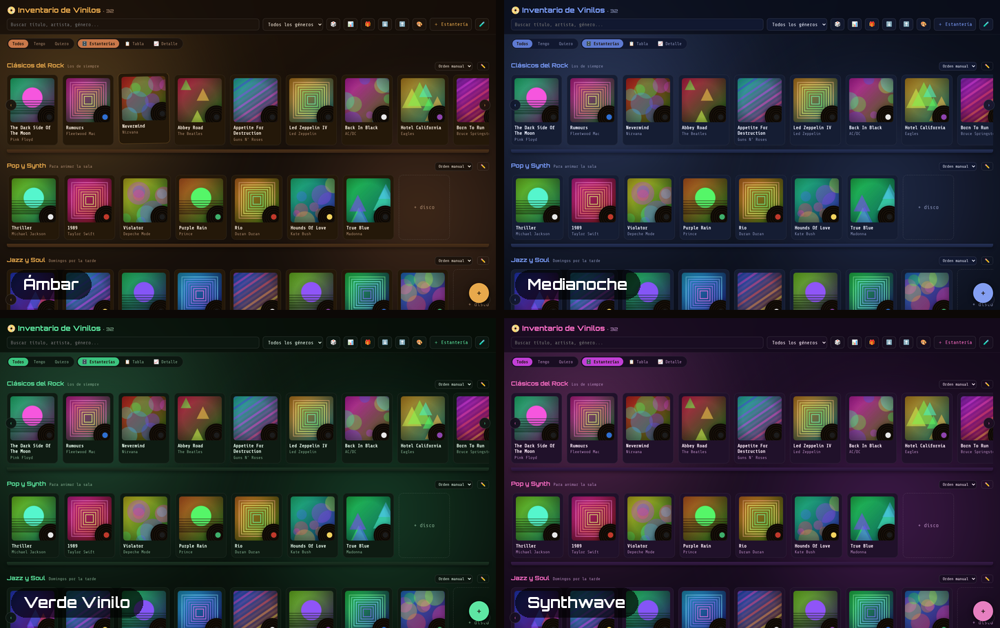
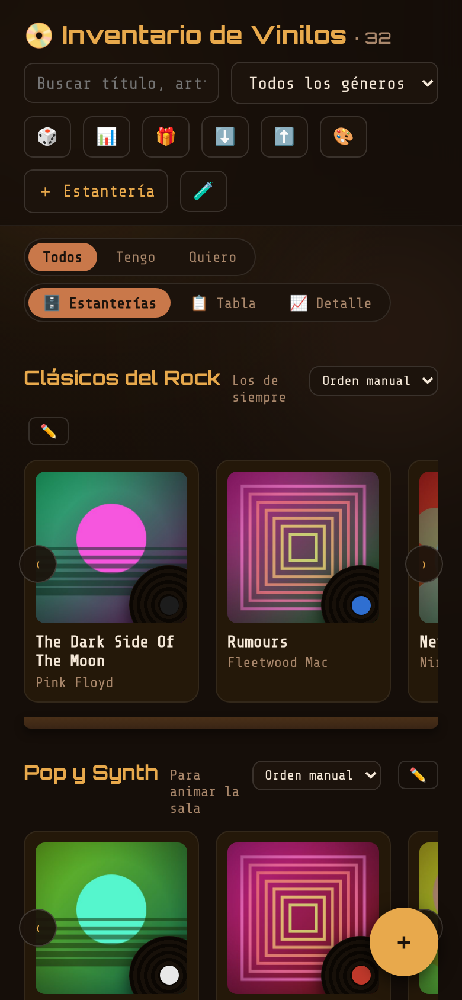

<p align="center">
  
</p>

<p align="center">
  <a href="https://ivanchux.github.io/inventario-vinilos/"></a>
  <a href="https://github.com/ivanchux/inventario-vinilos/actions/workflows/deploy.yml"></a>
  
  
  <a href="LICENSE"></a>
</p>

<p align="center">
  <b>Catálogo de vinilos con estanterías que se arrastran, ficha por disco, estadísticas y resumen anual.<br>
  Funciona sin conexión, se instala como app y no necesita backend.</b>
</p>

<p align="center">
  
</p>

> **Probar la demo:** abre el [enlace en vivo](https://ivanchux.github.io/inventario-vinilos/) y pulsa el botón 🧪 para cargar una colección de ejemplo sin rellenar nada a mano.

> Nació para digitalizar la colección de vinilos de mi padre (varios cientos de discos apuntados a mano desde los años 80) y ha acabado siendo un pequeño estudio de diseño de interfaz, PWA y modelado de datos sin backend.

## Funcionalidades

**Organizar la colección**
- **Estanterías arrastrables**: agrupa los discos por artista (o como quieras) en carruseles horizontales. Arrastra un disco para reordenarlo o moverlo a otra estantería; el orden puede ser manual o automático por año o título.
- **Tres vistas**: estanterías, tabla ordenable y una sección de detalle con gráficos por género, década, artistas, formato y valoraciones.
- **Filtros y búsqueda** por texto, género y estado (lo tengo / lo quiero), más un botón 🎲 que sugiere un disco al azar.

**Añadir y editar sin esfuerzo**
- **Asistente guiado**: en vez de un formulario largo, pregunta una cosa cada vez (título, artista, portada). El formulario completo sigue disponible como "modo avanzado".
- **Buscar portada en Google** con un clic, usando el título y el artista que ya has escrito, tanto al crear como al abrir un disco existente.
- **Fotos comprimidas automáticamente** al subirlas, para que miles de portadas no saturen el almacenamiento.
- **Diálogos propios y teclado**: confirmaciones con la estética de la app (sin `alert`/`confirm` del navegador), Enter para avanzar y Escape para cerrar.

**Cada disco, con detalle**
- Ficha independiente del formulario, con el vinilo animado: valoración, precio, color del vinilo, tracklist, etiquetas propias y notas.
- **Audio local**: si tienes la canción descargada, se reproduce ahí mismo y el vinilo gira al ritmo de la reproducción. Enlace a YouTube opcional.

**Estadísticas y recuerdos**
- Resumen del valor estimado, géneros y décadas dominantes.
- **Resumen anual estilo *Wrapped***, con aviso automático cada 365 días.

**Personalización**
- **Cuatro temas de color** (Ámbar, Medianoche, Verde Vinilo y Synthwave) que se aplican al instante y se recuerdan.

**Datos y seguridad**
- **Exportar / importar** en JSON para copias de seguridad o para mover la colección entre dispositivos.
- **PWA instalable y offline** (service worker; siempre carga la versión más reciente cuando hay conexión).
- **Sin backend, sin cuentas, sin analíticas**: todo vive en IndexedDB, en el propio dispositivo.

## Capturas

<table>
  <tr>
    <td width="50%"><br><sub><b>Estanterías</b>: carruseles que se desplazan y se reordenan arrastrando.</sub></td>
    <td width="50%"><br><sub><b>Ficha</b>: valoración, tracklist, etiquetas, audio local y búsqueda de portada.</sub></td>
  </tr>
  <tr>
    <td><br><sub><b>Asistente</b>: añadir un disco paso a paso, con búsqueda de portada integrada.</sub></td>
    <td><br><sub><b>Detalle</b>: estadísticas por género, década, artistas y más.</sub></td>
  </tr>
  <tr>
    <td><br><sub><b>Tabla</b>: vista ordenable para revisar muchos discos de un vistazo.</sub></td>
    <td><br><sub><b>Resumen anual</b>: un repaso animado de tu año en discos.</sub></td>
  </tr>
</table>

### Temas de color

<p align="center"></p>

### En el móvil

<p align="center"></p>

> Las portadas que aparecen en las capturas son ilustraciones abstractas generadas para la demo, no portadas reales de discos.

## Instalarla como app

- **iPhone (Safari)**: abre la demo → Compartir → *Añadir a pantalla de inicio*.
- **Android / ordenador (Chrome o Edge)**: menú del navegador → *Instalar aplicación*.

Tras la primera visita funciona sin conexión.

## Stack

Vanilla JS + HTML + CSS en un único archivo autocontenido: sin frameworks, sin dependencias, sin build step. Persistencia en **IndexedDB** (con migración automática desde versiones anteriores que usaban `localStorage`), PWA con `manifest.json` y Service Worker, y despliegue automático a GitHub Pages con GitHub Actions en cada push a `main`.

Elegido a propósito: cero dependencias y cero backend que mantener, y cualquiera puede abrir `index.html` y entender el código de arriba a abajo.

## Cómo probarlo en local

```bash
git clone https://github.com/ivanchux/inventario-vinilos.git
cd inventario-vinilos
python3 -m http.server 8000
# abre http://localhost:8000
```

Servirlo por `http://` (en vez de abrir el archivo con doble clic) evita limitaciones del navegador con el Service Worker y con `file://`.

## Estructura

```
├── index.html              # toda la app: HTML + CSS + JS
├── manifest.json           # metadatos de la PWA (nombre, iconos, colores)
├── service-worker.js       # caché offline
├── icons/                  # iconos para escritorio, iOS y Android
├── docs/                   # banner, capturas y GIF de este README
└── .github/workflows/      # despliegue automático a GitHub Pages
```

## Roadmap

- [ ] Selección múltiple para mover o borrar varios discos a la vez
- [ ] Filtros combinados (década + formato + condición)
- [ ] Reordenar estanterías con el teclado, no solo arrastrando (accesibilidad)
- [ ] Generalizar el modelo de datos para otras colecciones (libros, cómics, cartas...)

## Licencia

MIT: usa, copia y modifica libremente.
